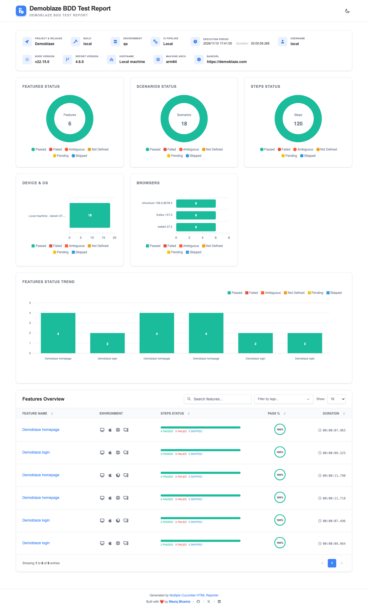

# Playwright Automation Claude Framework

[](https://github.com/Sand5/playwright-automation-claude-framework/actions/workflows/ci.yml)


End-to-end UI test framework for the [Demoblaze](https://demoblaze.com) demo store, built with **Playwright** and **TypeScript** using **BDD** (Gherkin feature files via [`playwright-bdd`](https://github.com/vitalets/playwright-bdd)) and the **Page Object Model**.

## Features

- BDD: scenarios in Gherkin `features/`, step code in `step-definitions/`, run by the Playwright runner
- Page Object Model with a shared `BasePage`
- Test data kept separate from features and steps (`test-data/`)
- Tagged scenarios (`@smoke`, `@login`) for targeted runs
- Cross-browser: Chromium, Firefox and WebKit
- Shared coloured `winston` logger with a configurable `LOG_LEVEL`
- Per-environment config (`qa`, `staging`) selected with `TEST_ENV`, with `BASE_URL` kept in the env files
- QA gate: TypeScript type-check, ESLint (Playwright rules) and Prettier
- Two HTML reports: Playwright's built-in one and a Cucumber-style report ([`multiple-cucumber-html-reporter`](https://www.npmjs.com/package/multiple-cucumber-html-reporter))
- GitHub Actions CI with both reports per browser and a manual environment picker

## Table of contents

- [Getting started](#getting-started)
- [Running tests](#running-tests)
- [Reports](#reports)
- [Code quality](#code-quality)
- [Project structure](#project-structure)
- [Configuration](#configuration)
- [Continuous integration](#continuous-integration)

## Getting started

**Prerequisites:** Node.js 22 or later and npm.

```bash
git clone https://github.com/Sand5/playwright-automation-claude-framework.git
cd playwright-automation-claude-framework
npm install
npx playwright install
```

The tests are written as Gherkin scenarios. `bddgen` turns the `.feature` files into Playwright specs in `.features-gen/` (git-ignored), and Playwright runs those. Every `npm run test:*` script does this for you. If you call `npx playwright test` directly, run `npm run bddgen` first after any change to a feature or step, or it runs stale specs.

Run Playwright commands from the project root, where it finds `playwright.config.ts`. Env files are loaded by [`config/load-env.ts`](config/load-env.ts) using paths relative to that file, so they load correctly even if you point at the config from elsewhere (`-c`).

## Running tests

| Command                                    | What it does                              |
| ------------------------------------------ | ----------------------------------------- |
| `npm run test:all`                         | Everything, on all three browsers         |
| `npm run test:chrome:headless`             | All scenarios on Chromium (headless)      |
| `npm run test:chrome:headed`               | All scenarios on Chromium (visible)       |
| `npm run test:webkit:headless`             | All scenarios on WebKit (headless)        |
| `npm run test:login`                       | Scenarios tagged `@login` on Chromium     |
| `npm run test:login:headed`                | `@login` scenarios on Chromium (visible)  |
| `npm run test:smoke`                       | Scenarios tagged `@smoke` on Chromium     |
| `npm run test:smoke:all`                   | Scenarios tagged `@smoke` on all browsers |
| `npm run test:tag -- @negative`            | Scenarios with any tag you pass, Chromium |
| `npm run test:feature -- homepage.feature` | One feature file, Chromium                |
| `npm run bddgen`                           | Only generate the specs from the features |

Handy extras:

```bash
npm run bddgen                        # regenerate specs first, then:
npx playwright test --ui              # UI mode
npx playwright test --debug           # step-through debugger
npx playwright test --workers=1       # ordered log output
npx playwright show-report            # open the last Playwright HTML report
```

Run against another environment with `TEST_ENV` (see [Environments](#environments)):

```bash
TEST_ENV=staging npm run test:all
```

Log verbosity is controlled with `LOG_LEVEL`:

```bash
LOG_LEVEL=debug npm run test:chrome:headless
```

## Reports

Each run writes two reports:

| Report          | Where                             | How to open                                                    |
| --------------- | --------------------------------- | -------------------------------------------------------------- |
| Playwright HTML | `playwright-report/`              | `npx playwright show-report`                                   |
| Cucumber HTML   | `cucumber-report/html/index.html` | `npm run report:cucumber`, then open `index.html` in a browser |



The report shows run info (environment, base URL, build, CI pipeline), status charts for features, scenarios and steps, the browsers used (name and version), and a searchable features overview. Open any feature to see every step with its status, duration and any failure.

`playwright-bdd` writes the Cucumber JSON (`cucumber-report/cucumber.json`) during the run. [`scripts/generate-cucumber-report.ts`](scripts/generate-cucumber-report.ts) then adds each feature's browser and version, and turns the JSON into the HTML report. The report uses generic values for the machine name and user (`Local machine` / `local`, or `GitHub Actions runner` / `runner` in CI), so it can be shared or screenshotted safely. Each test run overwrites the JSON, so generate the report straight after the run you want to look at. In CI both reports are uploaded for every browser, even when tests fail.

The image above is a screenshot from a local `npm run test:all` run, saved in `docs/images/`. It is not regenerated automatically, so retake it if the report's layout or options change.

## Code quality

| Command                 | Purpose                                        |
| ----------------------- | ---------------------------------------------- |
| `npm run typecheck`     | TypeScript type-check (`tsc --noEmit`)         |
| `npm run lint`          | ESLint with type-aware and Playwright rules    |
| `npm run lint:fix`      | ESLint with automatic fixes                    |
| `npm run lint:features` | gherkin-lint on the `.feature` files           |
| `npm run format:check`  | Prettier check                                 |
| `npm run qa:check`      | Typecheck, lint, feature lint and format check |

Run `npm run qa:check` before opening a pull request. Notable lint rules: no floating promises, no `console` (use the logger), no `waitForTimeout`, `force` or `test.only`, and no `expect` inside page objects.

### Claude Code skill: verify test outcomes

If you use [Claude Code](https://claude.com/claude-code), the repo includes a project skill, `verify-test-outcomes`, in [`.claude/skills/verify-test-outcomes/SKILL.md`](.claude/skills/verify-test-outcomes/SKILL.md). It reviews your feature files and the step definitions behind them, and checks that each scenario asserts a meaningful outcome of what its title claims, not just that elements are present. It flags things like actions with no result check, presence-only assertions, assertions that cannot fail, and hardcoded expected values.

Run it from the command line with:

```bash
claude -p "/verify-test-outcomes"
```

or use the npm shortcut, `npm run review:tests`. Inside an interactive `claude` session you can also type `/verify-test-outcomes`. It reports first and only changes code if you ask. The tests themselves run without Claude Code, and `review:tests` is not part of `qa:check` or CI.

To read the report in a nicely rendered view, save it to a file and open it in the VS Code Markdown preview:

```bash
npm run review:tests --silent > review.md
```

Then open `review.md` and press `Cmd+Shift+V` (`Ctrl+Shift+V` on Windows/Linux), or `Cmd+K` then `V` for source and preview side by side. `--silent` leaves out npm's own header lines. Don't commit the generated `review.md`.

## Project structure

```text
.
├── .claude/skills/            # Claude Code project skills (verify-test-outcomes)
├── .github/workflows/ci.yml   # GitHub Actions: QA gate, then browser matrix
├── env/                       # Environment files
│   ├── .env.qa                #   BASE_URL, LOG_LEVEL (default environment)
│   ├── .env.staging           #   Same keys for staging
│   └── .env.secrets.example   #   Template for git-ignored credentials
├── config/load-env.ts         # Loads env/.env.secrets and env/.env.<TEST_ENV> (one place)
├── logger/logger.ts           # Shared winston logger
├── pages/                     # Page objects (<name>.page.ts)
│   ├── base.page.ts           #   Abstract BasePage with navigate()
│   ├── home.page.ts
│   └── login.page.ts
├── test-data/                 # Expected values and credentials
│   ├── home.data.ts
│   └── login-data.ts
├── features/                  # Gherkin scenarios (what the tests do)
│   ├── homepage.feature
│   └── login.feature
├── step-definitions/          # Step code; assertions live here
│   ├── fixtures.ts            #   Page objects + alert recorder as fixtures; exports Given/When/Then
│   ├── hooks.ts               #   Before (log title) and After (logout for @login)
│   ├── home.steps.ts
│   └── login.steps.ts
├── .features-gen/             # Generated specs (git-ignored, from `bddgen`)
├── scripts/                   # generate-cucumber-report.ts (Cucumber HTML report)
├── docs/images/               # Screenshots used in this README
├── eslint.config.mjs          # ESLint flat config
├── playwright.config.ts       # Projects, retries, reporter
└── tsconfig.json
```

### Conventions

- Page objects extend `BasePage`, expose locators as `readonly` properties and log their actions. **No assertions in page objects.**
- Feature files say _what_ happens in plain language: no selectors and no expected values.
- Assertions live in step definitions (`Then` steps), not in page objects.
- Import `Given`/`When`/`Then`/`Before`/`After` from `step-definitions/fixtures.ts`, so steps get the page-object fixtures.
- Steps share state through fixtures, not local variables.
- The scenario title is logged in a `Before` hook. Scenarios tagged `@login` are logged out by an `After` hook.
- Expected strings and credentials come from `test-data/`, never hardcoded in features or steps.
- Tag scenarios (`@smoke`, `@login`, `@negative`) so they can be run with `--grep`.

## Configuration

- **Base URL:** read from `BASE_URL` in the env file (`https://demoblaze.com` in `env/.env.qa`) and passed to `baseURL` in `playwright.config.ts`. The config throws if it is missing. Use relative paths such as `/index.html` in page objects.
- **Browsers:** `chromium`, `firefox` and `webkit` projects. On CI the config uses 1 worker, 2 retries and fails on a stray `test.only`.
- **Reports:** Playwright HTML report in `playwright-report/`, artifacts in `test-results/`, and the Cucumber report (see [Reports](#reports)). All git-ignored.
- **Logging:** `LOG_LEVEL` is read from the env file (default `info`). A real environment variable overrides the file.

### Environments

`TEST_ENV` picks the env file, `env/.env.<TEST_ENV>`, and defaults to `qa`. Each file holds the non-secret settings for that environment (`BASE_URL`, `LOG_LEVEL`).

```bash
npm run test:all                       # qa (default)
TEST_ENV=staging npm run test:all      # env/.env.staging
```

To add an environment, create `env/.env.<name>` with its own `BASE_URL`. If the file does not exist, or `BASE_URL` is empty, the run stops with an error rather than falling back to a default. A real environment variable such as `BASE_URL=... npx playwright test` overrides the file.

### Credentials and secrets

Login credentials are read from the environment in [`test-data/login-data.ts`](test-data/login-data.ts), so features and steps never contain them.

| Where   | How                                                                                    |
| ------- | -------------------------------------------------------------------------------------- |
| Locally | Copy `env/.env.secrets.example` to `env/.env.secrets` (git-ignored) and set the values |
| CI      | Add `TEST_USERNAME` and `TEST_PASSWORD` as GitHub repository secrets                   |
| One-off | `TEST_USERNAME=... TEST_PASSWORD=... npx playwright test`                              |

The `env/.env.<name>` files are committed, so they hold only non-secret settings such as `BASE_URL` and `LOG_LEVEL`. Real environment variables override the files.

> **Demo-only fallback:** Demoblaze's public demo account (`test` / `test`) is used when `TEST_USERNAME` and `TEST_PASSWORD` are not set, so the repo runs out of the box. This is done for demo reasons only. In a real project there must be **no default credentials in code**: keep them in a secrets file or a secrets manager, and make the tests fail fast when they are missing.

## Continuous integration

[`ci.yml`](.github/workflows/ci.yml) runs on pushes to `main`, pull requests and manual dispatch. Pushes and pull requests test `qa`. To test another environment, open **Actions > CI > Run workflow** and pick it from the **Environment to test** dropdown (or run `gh workflow run ci.yml -f test_env=staging`).

1. **`qa`** runs `npm run qa:check`.
2. **`e2e`** runs only if `qa` passes. It generates the specs with `npm run bddgen`, then runs the full suite once per browser (Chromium, Firefox, WebKit) in parallel and uploads both reports for each browser as artifacts (`playwright-report-<browser>` and `cucumber-report-<browser>`).

The tests run against the live demo site, so an outage there can fail a build even when the code is fine.
